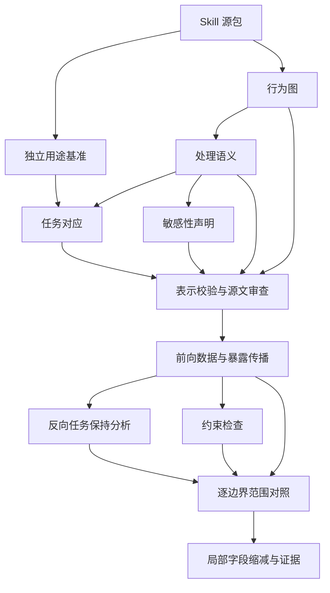

# SkillFlow 方法设计：面向 Agent Skills 的任务相关数据最小化

## 4.1 设计目标与核心思路（Overview）

Agent Skills 将自然语言描述的任务目的与脚本、接口和工具调用组合在同一执行流程中。敏感数据可能经过读取、筛选、重组和模型处理，最终进入消息、工具参数、存储或模型上下文。识别这些数据流只能回答“敏感信息到达了哪里”；判断数据过量暴露（Data Over-Exposure，DOE），还需要回答：**为了完成声明的任务，该接收位置究竟需要获得哪些信息？**

SkillFlow 围绕这一问题开展静态分析。我们以 Skill 的声明用途为功能保持基准，将具体暴露与完成任务所需的信息逐项对照，识别可从交付载荷中移除的敏感字段。分析覆盖任务流程中的各类暴露，包括额外动作产生的暴露，以及必要动作携带的多余内容。这里的用途基准描述 Skill 声明要完成的功能；实际部署中的用户授权由相应策略给出。

### 4.1.1 动机：动作必要性与载荷必要性

考虑一个通知 Skill：对启用通知的记录，将原始 `summary` 发送给该记录的 `recipient`。记录还包含用于内部访问的 `access_token`。以下两个实现执行相同的通知动作，但向接收方披露了不同的信息。

```text
任务：对 enabled 为真的记录发送 summary，并保持记录与 recipient 的对应。

输入 record：
    recipient, summary, enabled, access_token

实现 A：
    if record.enabled:
        payload = { summary: record.summary }
        notify(record.recipient, payload)

实现 B：
    if record.enabled:
        payload = {
            summary: record.summary,
            access_token: record.access_token
        }
        notify(record.recipient, payload)
```

通知动作、收件人选择和消息正文共同实现声明用途；附带的访问凭据则需要单独说明其必要性。**动作与任务相关，并不能直接推出该动作的全部载荷都应向接收方披露。**因此，SkillFlow 将判断粒度从动作进一步细化到特定接收位置上的字段及信息性质。

这个例子还揭示了观察时点的影响。若完整记录已先交给模型处理，即使通知工具最终只接收 `summary`，凭据也已经出现在模型的输入中。因此，同一字段的必要性需要结合接收主体、处理阶段和数据版本分析。这构成本文贯穿使用的两个问题：哪些内容到达了某个边界，以及该边界需要保留哪些内容。

### 4.1.2 三项关键设计

实现上述判断面临三个相互关联的困难。首先，任务目的与实现行为共同出现在源包中，直接根据现有载荷解释任务容易把附带内容吸收为需求。其次，字段在筛选、构造、循环和状态更新中不断改变位置与版本，单一敏感标签难以说明接收方究竟获得了什么。最后，一个字段可能在某处参与任务计算，却不需要随结果交给其他主体。

SkillFlow 通过以下设计解决这些困难。

1. **独立建立用途基准，再映射到具体行为。**我们先从源文提取任务要求，再将其与行为表示中的履约位置连接，使当前载荷的大小不会直接决定功能保持需求的范围。

2. **联合追踪内容、版本与观察边界。**我们保留字段组成、成员对应和数据更新关系，将每次交付绑定到当时的数据版本，从而区分原始内容、派生信息以及不同阶段的暴露。

3. **在同一接收位置对照前向暴露与反向需求。**我们从任务结果反推需要保持的信息，并在具体操作、参数槽和数据版本上检查敏感字段能否移除，再验证这一变化是否保持声明约束。

这三项设计构成 SkillFlow 的方法主线：**以独立用途为参照，以具体数据关系定位暴露，以任务保持分析支持局部缩减。**

### 4.1.3 分析流程与边界表示

SkillFlow 采用语义前端与确定性分析后端相结合的结构。前端利用 LLM 理解自然语言与代码中的目的、行为和处理机制，形成任务基准 \(T\)、控制流图 \(G\) 及语义标注 \(A\)。后端据此计算前向事实 \(F\)、反向保持需求 \(D\) 和约束检查结果，在逐边界对照后给出字段缩减依据。



**LLM 的职责是形成有源文依据的语义表示；跨步骤传播、需求推导和 DOE 判定由程序执行。**这种分工使每项判断能够沿统一的对象关系展开，并保留从源文到结论的推导依据。

我们将一次暴露实例记为：

\[
e=\langle o,s,r,d,\sigma,\gamma\rangle,
\]

其中 \(o\) 表示操作及其位置，\(s\) 表示输入槽，\(r\) 表示接收主体或位置，\(d\) 表示数据身份及版本，\(\sigma\) 表示成员或循环作用域，\(\gamma\) 表示保留的控制与候选关联。后续需求对照和缩减检查均使用这一粒度。例如，模型观察完整记录与通知工具接收消息载荷，分别形成独立的边界实例。

## 4.2 独立构建用途基准与行为表示（Separating Purpose from Behavior）

用途分析与行为分析面对同一份 Skill 源包，却需要回答不同的问题：前者确定应保持的功能，后者恢复数据处理的实际组织方式。若二者在提取时相互依赖，实现中出现的内容就可能反过来影响任务解释。在通知案例中，凭据已经出现在消息载荷里；如果据此将“发送凭据”纳入任务要求，后续分析便失去了识别多余字段的参照。

**我们的关键步骤是先独立建立用途要求，再将要求映射到行为，而不是从现有交付内容反推用途。**这种独立性由阶段输入决定：用途提取读取完整源包，但不接收后续构建的行为图、载荷分析、敏感性判断或 DOE 结果。

### 4.2.1 从声明用途提取保持基准

给定源包 \(S\)，用途提取识别声明目的、预期结果、执行条件、接收对象、必要副作用和禁止事项，形成任务基准 \(T\)。每项要求具有独立身份和源文依据；源文中的歧义与冲突也随要求保留。后续分析使用固定的基准版本，使要求与实现之间的映射能够被单独检查。

对于通知案例，基准包含三类要求：仅对启用记录执行通知；收件人与记录对应；消息保留该记录的原始 `summary`。这三项要求分别约束控制、接收者和消息内容。**将任务拆解为可定位的功能要求，使“必须执行的动作”与“必须保留的信息”能够在后续分析中分别表达。**

用途基准还为语义修订提供了稳定参照。源文审查发现遗漏时，修订围绕原始声明及其证据进行，并继续保持与载荷分析结果的输入隔离。

### 4.2.2 以暴露相关操作确定抽象粒度

行为表示需要保留足以解释暴露的关系。仅将整个脚本视作一个输入输出黑盒，会丢失字段筛选发生的位置和内容交付的时点；逐句展开所有计算，又会引入大量与暴露无关的细节。

我们以**数据获取、交付、保存、返回和状态版本变化**确定图的抽象粒度。前端首先梳理入口、来源、顺序、分支和接收关系，再构建控制流图。影响这些行为的操作和条件显式进入图中，纯局部计算则通过处理摘要表达。指令之间保留定义使用关系，字段与整体保留来源对应，处理结果绑定实际生产它的操作。

这一表示直接服务于后续判断。获取条件决定哪些内容进入流程；字段选择与对象构造决定接收载荷的组成；返回和交付位置决定哪些主体取得内容；写入与覆盖决定后续读取使用哪个版本。通知案例中的 `summary` 和 `access_token` 因而可以分别从原记录追踪到消息字段，而 `enabled` 的作用保留在实际控制位置。

## 4.3 将语义解释转化为分析依据（Grounding Semantics for Analysis）

控制流图描述操作如何连接，但 DOE 判断还需要三类语义：操作如何改变内容、任务要求在哪里实现，以及哪些来源信息敏感。将这些判断混合生成，容易让任务需求随敏感性判断变化，或让对某种结果的预期影响处理事实。SkillFlow 因此将它们分开形成，并通过共同的值与操作引用对齐。

### 4.3.1 对齐处理事实、任务要求与敏感来源

三类语义分别承担以下职责。

| 语义依据 | 回答的问题 | 与其他依据的关系 |
| --- | --- | --- |
| **处理语义 \(A_P\)** | 数据经过了哪些获取、选择、构造、计算和交付？ | 根据源文与行为图描述处理机制 |
| **任务对应 \(A_T\)** | 每项要求在哪里实现，需要保留哪些信息与行为？ | 将用途基准映射到已有操作及其输入输出 |
| **敏感性声明 \(A_S\)** | 哪个来源值、字段或信息性质属于敏感内容？ | 将源文中的敏感依据绑定到已有值及范围 |

**共享对象引用使三类判断能够相互对照，输入隔离则保持各自的判断依据。**任务对应读取用途基准和处理语义，不读取敏感性结果；敏感性分析读取源文与处理表示，不读取用途基准或任务对应。这样，某字段是否敏感不会决定它是否属于任务需求，某项任务需求也不会改变原有数据处理事实。

任务对应进一步区分位置绑定、保持需求和行为约束。位置绑定指出要求在哪些操作中实现；保持需求规定结果应保留的值、结构或动作；行为约束规定交付对象、执行条件、次数和先后关系。未被完整表达的要求保留其对应缺口，供后续判断使用。

在通知案例中，消息中的原始 `summary` 对应内容保持需求，通知动作对应执行与成员关系要求，启用条件对应控制要求。敏感性声明则单独绑定到来源记录的 `access_token`。这为后续建立两条独立路径奠定基础：凭据如何进入载荷，以及通知用途为什么需要保留某些内容。

### 4.3.2 从处理机制导出观察边界

相同的数据变换可能产生不同的暴露。考虑从完整记录中选取 `summary`：如果筛选由本地脚本执行，模型可以只接收筛选结果；如果完整记录先交给模型，再由模型选择字段，观察就发生在筛选之前。**处理位置决定谁能看到数据，观察时点决定其看到哪个版本。**

SkillFlow 将处理机制显式纳入语义，并依据统一执行契约编译观察事件。

| 处理机制 | 观察规则 |
| --- | --- |
| 模型处理（`model`） | 在使用段外输入前，以及读取或接收新内容后，记录相应模型观察 |
| 本地处理（`local`） | 将内部计算保留在本地，对显式回传值记录模型观察 |
| 未明确隔离（`default`） | 根据统一契约保留输入或返回内容可能被模型观察的关系 |

因此，两种字段选择形成不同的传播路径：

```text
本地读取完整记录 → 本地选择 summary → 模型观察 summary
完整记录进入模型 → 模型观察完整记录 → 选择 summary
```

本地处理中的显式外发仍按相应交付边界建模。系统统一考虑网络发送、持久或跨主体存储、跨任务或跨主体上下文、模型观察、外部工具接收和明确的用户输出。内部读取与中间计算通过数据关系连接这些边界，使后端能够沿完整处理过程定位暴露。

### 4.3.3 保持表示与源文的一致性

语义分析的质量取决于前端表示能否保留图结构，并准确反映源文。我们分别检查这两类一致性。

首先，编译后的图记录经 Lean 打印、解析和恢复进行文本往返校验，检查显式身份、操作数、作用域和图关系在转换中保持：

\[
\operatorname{Recover}(\operatorname{Parse}(\operatorname{Print}(G)))=G.
\]

其次，源文审查将结构化 CFG、用途基准、语义标注和编译后的观察与完整源包对照，定位遗漏动作、错误字段关系、过宽需求或不当处理机制。**表示校验保留结构关系，源文审查核对这些关系所表达的含义。**

语义修订按照依赖关系展开：一项处理事实改变时，依赖它的任务对应与敏感性声明需要同步重建；用途要求修订时，则维持用途提取的输入隔离。我们采用一轮语义修复并重新审查修订后的组合，使纠正过程保持有界，同时避免新旧语义相互混用。后续确定性分析据此使用一致的任务、图和标注版本。

## 4.4 保留内容与接收关系的前向传播（Relational Forward Propagation）

前向分析恢复敏感信息到达接收位置的过程。其关键困难在于：数据会改变结构，变量会绑定不同版本，循环中的载荷又必须与正确的成员和接收者对应。SkillFlow 因而以**带有来源和版本的数据关系**为传播对象，同时保留内容变换与候选之间的关联。

### 4.4.1 区分内容保留与信息派生

SkillFlow 用 Data 表示来源整体、组成字段和处理结果。原样传递复用数据身份；字段选择保留父对象及路径；构造、排除和更新形成新的内容表示。由此，一个字段是否仍出现在载荷中，可以沿实际组成关系判断。

内容关系与计算依赖承担不同作用。例如，`record.summary` 是原字段的选择，而 `summarize(record)` 是由记录计算得到的新结果。二者可能具有相似的业务名称，却对应不同的信息关系。我们分别记录**直接内容、明确派生和可能影响**，使字段原值的传递与计算结果对输入的依赖能够被区分。

| 处理关系 | 前向分析保留的信息 |
| --- | --- |
| 选择与构造 | 输出字段与实际贡献该内容的输入及路径 |
| 排除与覆盖 | 基础内容、被移除的范围和覆盖它的新值 |
| 筛选与成员映射 | 输出成员、来源成员及对应的处理结果 |
| 明确计算 | 结果与输入之间的派生关系 |
| 不透明计算 | 结果与相关输入之间的可能依赖 |

**敏感信息的来源与当前载荷的内容共同决定暴露范围。**在通知案例中，对象构造将凭据原值放入 `payload.access_token`，可以建立精确字段映射；后续若排除该字段，新的载荷关系保留剩余内容，而来源记录仍保持原有身份。来源可追溯性与字段是否实际保留，因而能够同时表达。

### 4.4.2 保留成员、接收者与载荷的关联

分支和循环使同一操作可能接收多个候选值。若分别汇总每个变量，再自由组合候选，分析可能将记录 A 的收件人与记录 B 的消息配对，形成缺乏程序依据的暴露路径。

SkillFlow 采用关联状态行保存共同前驱、成员、数据候选与版本。每行描述一组相容绑定，操作仅在这些绑定上组合输入。对于基本块 \(b\)，传播过程可写为：

\[
\operatorname{IN}_b
=\bigcup_{p\in\operatorname{Pred}(b)}
\operatorname{EdgeRows}(p,b),
\qquad
\operatorname{OUT}_b
=\operatorname{Transfer}_b(\operatorname{IN}_b).
\]

这里的并集保留完整状态行。**前驱选择与成员身份贯穿字段读取、参数构造和交付，使“谁的数据交给谁”成为传播关系的一部分。**在通知循环中，同一成员的 `recipient`、`summary` 和 `access_token` 始终保持共同来源；即使不同成员包含相同值，也保留各自的成员身份（occurrence）。

这一关联还用于描述调用与返回候选。同一成员的多个可能结果是替代选择，不能被误计为多个来源成员。保留这些区别，为后续任务需求中的成员对应和数量保持提供依据。

### 4.4.3 将观察绑定到当时的数据版本

数据最小化的效果取决于修改发生的位置。后续删除字段可以减少之后的交付，却无法改变先前已经发生的观察。为表达这种时序关系，SkillFlow 将状态更新与历史暴露分别保存。

对于确定单一位置的覆盖，分析更新后续读取的绑定；存在别名或汇总关系时，保留可能更新的候选。追加建立旧内容与新增内容的组合关系。删除确定位置时清空相应绑定，对可能别名、符号或汇总位置的弱删除则保留尚未排除的旧候选。

**每次暴露固定引用交付时的数据版本。**例如，完整记录先进入模型，随后才构造不含凭据的通知消息，则模型观察关联原记录，通知交付关联新消息。两处边界可以得到不同的缩减结论，修改位置也由各自的数据关系确定。

### 4.4.4 以有限摘要求解循环

逐项通知、重试和累计结果要求分析跨越循环，同时保持成员与调用的对应。如果每次迭代都递归构造更长的数据身份，分析状态将持续增长。我们因此从 CFG 识别循环及嵌套作用域，基于有限的定义、候选、成员和位置关系构建摘要。

**循环迭代增长的是可合并的关系事实，稳定后形成摘要结果。**逐项处理保留源成员与产出关系，重试保留调用及替代结果，累计集合保留初始内容与后续贡献。分支传播使用已表达的条件关系，部分顺序遵循显式因果与定义使用关系。

求解以基本块的关联分区为单位，依据实际读取的数据与字段依赖重新调度；活性投影移除后续计算不再需要的绑定。操作输入输出、成员、接收者及版本关系作为分析证据保留，使求解状态的压缩不会丢失解释暴露所需的联系。

对未建模的处理，分析保留已经计算的前缀，并将缺口关联到受影响的结果、状态或控制区域；依赖这些结果的传播相应标记为未解析，独立分支继续求解。前向结果因而同时提供暴露事实及其相关覆盖信息，供 DOE 判断检查证据是否完整。

## 4.5 从任务结果反推保持需求（Backward Task-Preservation Analysis）

一项通知任务需要正确选择记录、保持收件人与记录的对应，并交付规定的消息内容。这些要求分别作用于控制条件、参数和消息字段。仅凭某个数据参与过任务，无法确定它在哪些接收位置必须出现。

我们将任务要求转化为带有位置和信息性质的保持需求，从实际履约位置沿处理关系反向传播。**反向分析的起点由任务要求确定，当前载荷中额外包含的内容不会自动成为需求种子。**在通知案例中，原始 `summary` 的保持要求绑定到实际消息字段，凭据是否同时存在于 payload 不改变该种子的范围。

### 4.5.1 以信息性质刻画任务依赖

保持任务结果并不总是要求保留输入的全部内容。判断字段是否存在、统计集合数量和复用字段原值，分别依赖不同的信息性质。SkillFlow 使用六类保持需求表达这些区别。

| 性质 | 需要保持的信息或行为 | 典型作用 |
| --- | --- | --- |
| `value` | 值或字段原始内容 | 保留消息中的 `summary` |
| `presence` | 字段存在性 | 保持可选字段是否存在 |
| `cardinality` | 集合数量 | 保持匹配记录的计数 |
| `shape` | 相关集合结构 | 保持结果的组织关系 |
| `truth` | 条件结果及其所需信息 | 保持通知的启用条件 |
| `action` | 动作及控制、迭代关系 | 对所选成员执行通知 |

**需求描述任务依赖的信息性质，再由实际运算决定它如何回溯。**例如，受支持的计数关系将结果需求映射为集合基数需求；字段存在性判断将需求定位到相应字段的存在性。这些规则使原值、存在性和结构要求能够分别参与后续范围对照。

一个需求种子记为：

\[
g=\langle id_g,id_r,n,\pi,\rho\rangle,
\]

其中 \(id_r\) 指向源文任务要求，\(n\) 表示结果、参数或动作位置，\(\pi\) 为字段或成员路径，\(\rho\) 为保持性质。一个要求可以产生多个种子，例如分别保持通知收件人、正文与执行条件。种子之间保留独立身份，以便解释同一数据对不同要求的作用。

### 4.5.2 沿内容、成员与版本关系传播需求

反向传播读取前向分析已经建立的实际输入输出与来源关系。对于操作 \(o\)，令 \(F_o\) 表示其前向事实，\(B_o\) 表示对应的反向规则，则需求更新为：

\[
D^{g}_{\mathrm{in}}
\leftarrow
D^{g}_{\mathrm{in}}
\cup B_o(D^{g}_{\mathrm{out}},F_o).
\]

新增推导进入工作队列，直至不再产生新的需求。传播过程主要通过三类机制跨越复杂处理。

**沿内容映射定位需求。**字段选择将结果需求定位到输入对象的相应路径；对象构造将输出字段连接到真正贡献该内容的输入；字段排除只沿仍保留的范围回溯；字段更新则将被覆盖路径指向新值，其余路径指向原对象。因此，保持消息中的 `summary` 可以回到来源记录的 `summary`，同时保留它与消息字段之间的实际映射。

**沿成员与控制关系保持行为。**筛选与成员映射同时涉及内容和执行范围。分析沿 occurrence 保留源成员及其结果的对应，并追踪决定成员选择和动作执行的条件。对于通知动作，`enabled` 及相应成员关系参与保持需求，保证消息字段的缩减与通知对象的选择能够分别分析。

**沿版本关系追溯实际来源。**对保存后读取的数据，需求沿到达读取位置的写入版本回溯。对已知表达式，按字段、存在性、计数、比较和逻辑关系传播相应性质；对不透明计算，为保持其所需输出，保守保留相关输入及推导原因。所有规则共同使用前向事实中的版本、成员和操作关系。

### 4.5.3 在具体接收位置汇集需求

通知案例中的三个字段承担不同角色：`enabled` 决定是否执行通知，`recipient` 决定接收者，`summary` 构成消息内容。三者共同支持任务，但应分别出现在控制位置、收件人参数和消息参数的需求集合中。

**字段的必要性属于具体位置与用途，不能仅由它是否在任务中被使用决定。**SkillFlow 在每个边界实例 \(e\) 上收集适用需求，得到 \(D_e\)。其中，操作、输入槽和数据版本共同决定比较对象，使控制条件的需求不会被直接扩展为消息接收方对该字段的需求。

当不同要求到达同一个值时，分析仍分别保留种子、父推导与应用规则，随后按边界聚合。这既支持多个任务要求共同约束一个载荷，也允许解释每项保留需求具体来自何处。

模型观察同样按其自身位置分析。观察内容在后续步骤中承担的用途，以及已知处理关系能够反推出的信息，共同决定该观察边界的需求。不透明模型计算产生相应的保守需求，并进入同一范围对照过程。

### 4.5.4 分离功能保持与行为约束

任务要求还可能限制数据去向、执行条件、次数和先后关系。这些限制与“需要保留哪些信息”相关，却具有不同逻辑作用。例如，“不得向通知服务发送凭据”要求分析凭据是否到达该服务，但不会使凭据成为该服务所需的消息内容。

**行为约束独立于保持需求求解。**SkillFlow 将这些约束记为 \(\mathcal C\)，先依据原始前向事实检查其满足情况；当分析提出局部字段缩减时，再检查候选变化是否保持每条声明约束。前一个检查描述原始行为，后一个检查评价具体修改。这样的分工使需求范围与禁止、条件、次数及顺序要求能够分别表达，并在最终判断中汇合。

## 4.6 建立局部缩减依据并解释过量暴露（Detecting and Explaining Excess Exposure）

DOE 判断需要将两侧分析汇合：前向关系说明敏感内容如何到达边界，反向需求说明该边界为何需要保留某些信息。我们进一步检查字段排除对声明约束的影响，以**一项有任务保持依据的局部缩减**支持过量暴露结论。

### 4.6.1 将敏感来源映射到当前载荷

敏感性声明首先绑定来源值及其字段范围，再沿前向内容关系传播。选择、构造、排除和覆盖提供范围映射；计算结果则保留派生或可能影响关系。到达边界的敏感信号记为：

\[
a=\langle d,\pi,\rho,\lambda,\kappa\rangle,
\]

其中 \(d\) 为数据版本，\(\pi\) 为信息路径，\(\rho\) 为信息性质，\(\lambda\) 为敏感类别，\(\kappa\) 表示直接内容、派生信息或可能影响。

这一表示将敏感性定位到载荷内部。实现 B 中，来源 `record.access_token` 经对象构造进入 `payload.access_token`，形成直接字段关系；如果输出来自不透明计算，则保留相应影响关系。**精确的字段位置与关系类型，决定分析能够支持何种缩减判断。**

### 4.6.2 以需求对照确定字段候选

对边界实例 \(e\)，我们将敏感范围与适用需求 \(D_e\) 对照，检查字段路径、信息性质、成员作用域和排除范围是否冲突。比较同时考虑精确需求与保守需求，因此一个字段即使不承担原值需求，也可能因存在性或结构要求而需要保留。

字段缩减以局部字段排除为单位。候选条件写为：

\[
\begin{aligned}
\operatorname{Candidate}(e,\pi)\iff{}&
\operatorname{DirectSensitiveValue}(e,\pi)\\
&\land (D_e\neq\varnothing)\\
&\land \operatorname{DisjointFromDemands}(\pi,D_e)\\
&\land \operatorname{FieldExclusionSupported}(e,\pi)\\
&\land \operatorname{NoBlockingGap}(e).
\end{aligned}
\]

这些条件分别建立直接敏感字段、同槽保持需求、需求相离、字段排除适用性和相关证据完整性。范围对照据此落实到**同一操作、同一输入槽和同一数据版本**，后续约束检查继续使用该实例。

在通知案例中，消息槽的保持需求定位到 `summary`，凭据原值则定位到 `access_token`。两者在消息中的范围相离，因此凭据可以进入字段排除候选。候选作用于这次交付的消息，不改变共享来源记录在其他位置的使用。

### 4.6.3 检查缩减对声明约束的影响

字段处于保持需求之外，仍需考虑删除它是否改变后续行为。例如，工具可能根据请求内容产生不同响应，响应又可能影响后续条件或存储。我们从候选操作、输入槽、数据版本和字段路径出发，沿处理、控制、请求响应及读写关系计算变化影响，再检查其与声明约束的关系。

**局部缩减既要保留该位置的任务需求，也要保持受其影响的行为约束。**分析使用以下三类保持依据。

| 保持依据 | 适用条件与作用 |
| --- | --- |
| **结构保持** | 约束作用域完整，原始结构检查独立于值与条件选择成立；候选操作位于成员作用域之外，变化不改变成员集合与作用域，据此保持相应次数或先后关系 |
| **终态内容子集** | 对作用域完整的内容禁止约束，候选位于显式终态交付；该交付为非自动生成的 `deliver`，完整影响分析确认没有其他受影响操作，字段排除只减少原始内容 |
| **无相关影响** | 约束作用域完整，且完整变化传播不触及约束所关注的内容、条件、事件或作用域，据此保持与候选无关的约束 |

令 \(\operatorname{Preserve}_{\mathcal C}(e,\pi)\) 表示每条声明约束均得到保持依据，则：

\[
\operatorname{ExcessSupported}(e,\pi)
\iff
\operatorname{Candidate}(e,\pi)
\land
\operatorname{Preserve}_{\mathcal C}(e,\pi).
\]

该判断将暴露位置与具体修改连接起来。在通知案例中，字段排除保留消息正文、接收者和执行条件，并通过相关约束保持检查后，即可支持在本次消息交付处移除 `access_token`。原始约束检查结果与候选保持结果分别保留，以便同时解释原行为及这项局部修改。

### 4.6.4 通过证据链解释判断

我们将判断归纳为三类，分别反映已经建立的缩减依据或仍需区分的信息关系。

| 判断 | 含义 |
| --- | --- |
| **支持过量暴露** | 直接敏感字段通过需求对照和约束保持检查，可定位到具体字段排除 |
| **可能过量暴露** | 相关缺口与已有保持需求未阻断判断，但敏感来源仅通过派生或可能影响关系到达载荷 |
| **未建立过量暴露** | 保持需求、结构要求或相关缺口尚不支持具体字段缩减 |

判断依据围绕暴露关系与保持需求组织；对于通过需求对照的字段候选，进一步记录变化影响与约束保持依据：

```text
暴露路径：
源文敏感声明 → 来源字段 → 内容变换与版本 → 边界实际载荷

保持路径：
源文任务要求 → 履约位置 → 需求种子 → 反向推导 → 边界保持需求

两条路径在同一操作、输入槽和数据版本上汇合
                         ↓
             范围对照与候选变化影响
                         ↓
                约束保持与缩减结论
```

**支持字段缩减的证据同时解释敏感内容的到达过程，以及移除该字段的任务保持依据。**对通知案例，暴露路径从来源凭据到消息字段，保持路径从通知用途到 `summary`、收件人与成员对应，约束分析则解释字段排除的影响。分析保留支撑该结论的源文引用、数据关系和逐种子推导，使每项建议能够回到具体修改位置复核。

所有暴露边界均进入对照。未建立正向保持需求的载荷保留暴露及诊断；局部字段排除需要上述候选条件，整动作删除不属于该规则。模型观察与最终交付分别分析：若凭据已在消息缩减之前进入模型，减少该次模型暴露需要将字段选择前移到首次观察之前，并保留该阶段的任务需求。由此，结论不仅指出可减少的内容，也定位减少暴露应发生的处理阶段。

### 4.6.5 算法概览

下面的算法概括语义前端完成后的确定性分析。前向事实为需求传播、敏感范围追踪和约束检查提供共同依据；最终循环在具体边界实例上组合这些结果。

```text
Algorithm: Task-Preserving Exposure Analysis
Input:  task baseline T, graph G, semantic annotations A
Output: exposure judgments, local field reductions, and evidence

1.  F ← ForwardPropagate(G, A.processing)
2.  D ← BackwardDemand(T, A.task_correspondence, F)
3.  L ← PropagateSensitiveRanges(A.sensitivity, F)
4.  C ← A.constraints
5.  Q ← CheckOriginalConstraints(C, F)

6.  for each exposure operation o in F:
7.      for each payload slot s and data candidate d at o:
8.          e ← BindBoundary(o, s, d)
9.          demands ← SelectApplicableDemands(D, e)
10.         for each sensitive signal a in SelectSensitiveRanges(L, d):
11.             result ← CompareRangeAndProperty(a, demands, Coverage(e))
12.             if result establishes an exact field-exclusion candidate:
13.                 P ← CheckPreservation(o, s, d, a.path, C, Q, F)
14.                 if every declared constraint has preservation support:
15.                     Report(e, SupportedExcess, ExcludeField(a.path), evidence)
16.                 else:
17.                     Report(e, NoExcessEstablished, P.reasons)
18.             else:
19.                 Report(e, result, supporting evidence)

20. Retain unresolved boundaries and their analysis gaps
21. Return judgments and the supporting derivation closures
```

<details>
<summary>写作核对依据（不属于论文正文）</summary>

以下链接保留方法与项目材料的对应，供后续修改核对。

| 方法内容 | 对应材料 |
| --- | --- |
| 任务相关最小化目标 | [DOE 目标与设计原则](D:/projects/SkillFlow/docs/doe/SkillFlow-DOE目标与设计原则.md) |
| 用途提取、语义隔离与依赖修订 | [文档引导式分析](D:/projects/SkillFlow/docs/doe/document-guided-analysis.md)、[前端编排](D:/projects/SkillFlow/src/skillflow/document_guided/runner.py) |
| 图记录往返与源文审查 | [受控回述保证](D:/projects/SkillFlow/formal/CONTROLLED_RETELLING.md)、[源文审查](D:/projects/SkillFlow/src/skillflow/document_guided/source_review.py) |
| 字段关系与观察机制 | [字段关系与观察编译](D:/projects/SkillFlow/docs/propagation/SkillFlow-字段关系与观察编译.md)、[Sink 边界](D:/projects/SkillFlow/docs/propagation/SkillFlow-Sink边界与固定分级.md) |
| 内容与数据版本 | [Data 结构与更新规则](D:/projects/SkillFlow/docs/propagation/SkillFlow-Data数据结构与更新规则.md) |
| 关联传播与循环摘要 | [通用循环设计](D:/projects/SkillFlow/docs/doe/general-loop-analysis.md)、[后端计算契约](D:/projects/SkillFlow/docs/propagation/backend-computation-contract.md) |
| 任务保持需求 | [反向需求规范](D:/projects/SkillFlow/docs/doe/backward-demand.md)、[需求分析](D:/projects/SkillFlow/src/skillflow/doe/demand_engine.py) |
| 敏感范围与候选判断 | [敏感范围对照规范](D:/projects/SkillFlow/docs/doe/sensitivity.md)、[DOE 对照](D:/projects/SkillFlow/src/skillflow/doe/sensitivity_engine.py) |
| 约束与候选影响 | [约束实现说明](D:/projects/SkillFlow/docs/doe/constraint-implementation.md)、[约束保持](D:/projects/SkillFlow/src/skillflow/doe/constraint_preservation.py) |

</details>

