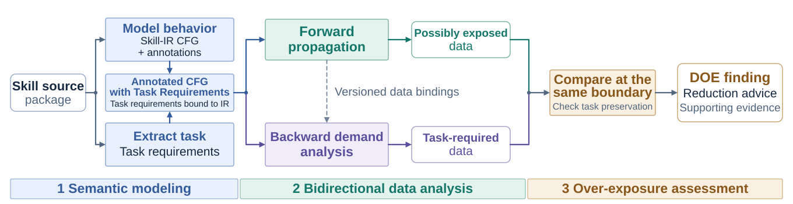
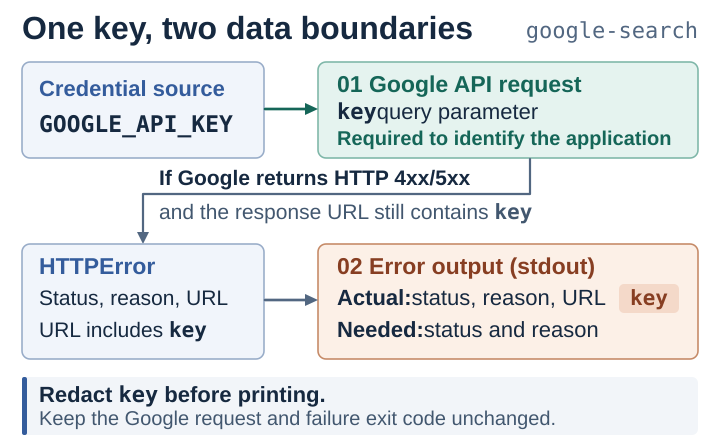

### 4.1 Overview

SkillFlow 对 Agent Skill 开展静态审计，依据技能声明的用途和要求，判断各数据边界上可能暴露的敏感数据是否超出任务需要。方法分为三个阶段。第一阶段由语义前端对技能的任务要求和实际行为进行建模。第二阶段基于第一阶段的产物进行前向数据流传播和反向需求分析，分别确定各数据边界可能暴露哪些数据，以及完成任务需要在这些位置保留哪些数据。第三阶段在各数据边界对照两项分析的结果，给出数据过量暴露判定和缩减建议。

图 1 展示 SkillFlow 三个阶段的输入、输出及其衔接。

*图 1　SkillFlow 方法总览。*

下文以开源 Skill [google-search](https://clawhub.ai/mxfeinberg/skills/google-search) 为例。该 Skill 调用 Google Custom Search API 执行网页搜索。脚本从环境变量读取 API 密钥，并将其作为查询参数 `key` 发给 Google。若请求收到 HTTP 4xx 或 5xx 响应，且响应 URL 仍含 `key`，Requests 生成的异常消息就会带上该 URL，脚本随后将消息原样打印到标准输出。图 2 根据源码展示这条条件路径及其缩减位置。

Skill 源文通常将预期结果、行为约束和实现步骤写在一起。为区分技能应当完成的任务与实际实现采用的做法，SkillFlow 分别对两者建模。在任务建模一侧，SkillFlow 让 LLM 仅依据完整源包识别声明的用途，将应保持的结果和行为约束拆为可分别核对的任务要求，并为每项要求记录原文出处。这一过程独立于行为建模和后续的数据流分析，避免把当前实现传递的字段直接视为任务所需。

在实际行为建模一侧，SkillFlow 从源文提取操作及其执行关系，由程序将其组织成**带有显式数据依赖的控制流图（Control Flow Graph，CFG）**。图中的基本块描述操作在块内的执行顺序，块间的边描述执行可以转向哪里以及何时转向。每个块由一列 Skill-IR 指令构成，指令通过定义和引用结果记录数据依赖。例如，发送请求的指令引用前一步构造的请求。

记一条 Skill-IR 指令为 $i=(\mathrm{id},\mathrm{op},I,O)$，分别记录指令标识、操作、有序输入和有序输出。输入可以是字面值、上下文键、资源引用或已定义结果的引用。每个结果标识对应唯一的静态定义位置。原始上下文键由获取指令读取，后续操作通过该指令产生的结果使用相应的数据。记 CFG 的核心结构为 $G=(B,E,b_0,C)$，其中 $B$ 是基本块集合，$E$ 是块间控制边集合，每条边 $e=(b,b',g)$ 记录源块、目标块及可选条件，$b_0$ 是指定入口块，$C$ 是已声明的上下文键集合。编译时，SkillFlow 检查同块结果是否先定义后使用，以及跨块结果的定义块是否能沿控制边到达使用块。具体路径上可用的是哪个数据版本，由后续传播确定。

在此基础上，SkillFlow 通过语义标注描述各操作如何选取、组合或改写输入字段，并标记敏感数据及其来源。SkillFlow 将独立提取的任务要求关联到 CFG 中相应的结果、条件或操作效果，明确这些位置需要保持的信息或行为。经源文审查后，第一阶段交付**带任务要求的标注 CFG（Annotated CFG with Task Requirements）**，其中保留字段处理和敏感来源标注、任务要求及其源文依据，以及任务要求与履行位置的对应关系。这一阶段有两个核心挑战。

- **字段级数据表示。** 如何在指令的输入输出之间表达字段的选取、保留和改写关系，使同一套关系支持前向传播和反向需求分析。
- **源码动作与执行效果的对齐。** 如何在同一条 IR 覆盖多个源码动作时，分别表示调用、结果返回、状态更新和数据交付，并明确各自涉及的数据及其去向。

在 `google-search` 中，CFG 分别表示凭据读取、请求构造与发送，以及成功返回和失败输出两条路径。语义标注将 `GOOGLE_API_KEY` 标为敏感来源，并记录其进入查询参数 `key` 的关系。

各数据边界可能暴露的内容取决于上游如何处理和传递数据，而各位置需要保留的信息取决于下游需要满足的任务要求。SkillFlow 因此基于同一个带任务要求的标注 CFG 沿两个方向开展分析。前向传播使用其中的控制关系和字段处理标注，沿控制流计算数据如何变化和传递。分析用带有版本标识的 `Data` 记录字段内容及其来源，并保留同一次操作中哪些输入版本可能共同出现。据此，SkillFlow 记录哪些字段版本可能到达各接收方或保存位置。敏感来源标注为后续识别这些传播记录中的敏感数据提供依据。

反向分析从绑定到具体履行位置的任务要求出发，根据该处需要保持的字段内容、条件或操作效果，结合处理标注沿数据依赖回溯上游所需的信息。分析依据 CFG 识别相关执行条件，并利用前向传播记录的绑定确定所涉及的数据版本。在此基础上，SkillFlow 结合操作语义和接口要求，逐条评估 IR 实际使用的参数和字段，区分完成所需输出或操作效果必须保留的输入、可省去的输入和仍然未决的输入。这项检查用于识别 Skill 实现中超出任务需要的数据收集或传递。在实现上述双向分析时，存在两个核心挑战。

- **复杂控制流中的数据版本配对。** 分支、循环和反复读写会使同一位置使用不同的数据版本。难点在于区分这些版本，并保留同一分支或同一循环成员中的载荷与接收方配对。
- **复杂控制流中的传播收敛。** 逐轮展开循环会使版本和来源关系持续增长。难点在于用有限的关系摘要表示反复更新，并保留后续分析所需的数据关系。

在 `google-search` 中，前向传播说明同一密钥如何进入 Google 请求，以及在上述条件下如何随 URL 和异常消息到达标准输出。反向分析分别考察两处的保留需求。Google 接口要求使用 `key` 标识调用应用，因此请求需要携带密钥。错误输出需要报告搜索失败及其原因，这一任务无需在诊断信息中提供密钥。

最后，SkillFlow 在同一数据边界的具体参数位置和数据版本上，对照可能暴露的敏感数据与任务所需的信息，定位可进一步检查的删减候选。对于每项候选，SkillFlow 检查删减后能否保持相关任务结果和行为约束，并将证据不足的范围保留为未决。具备保持依据时，SkillFlow 给出具体的缩减位置和内容，并记录敏感数据的来源、传播路径及相应的源文依据，供审查者复核。

在 `google-search` 样例中，缩减位置是失败分支的错误输出。一种改法是在构造诊断信息时去除 URL 中 `key` 的值，保留 HTTP 状态码、错误原因和原有退出码。发给 Google 的请求仍携带完成搜索所需的密钥。

*图 2　google-search 中同一密钥在两个数据边界上的必要性。*

样例依据：[Skill 源码](../experiments/doe/inputs/clawhub-top1000-v1/items/0212-mxfeinberg-google-search/attempts/20261020T093012481297Z-f16cd7/files/scripts/search.py)、[Google 请求参数规范](https://developers.google.com/custom-search/v1/using_rest#make_a_request)、[Requests 2.32.5 的异常构造](https://github.com/psf/requests/blob/v2.32.5/src/requests/models.py#L936-L947)。
